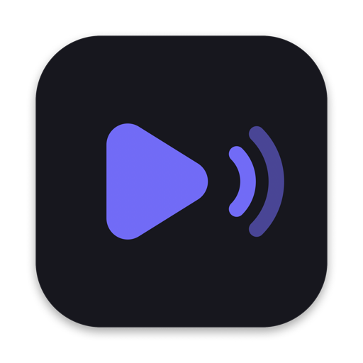
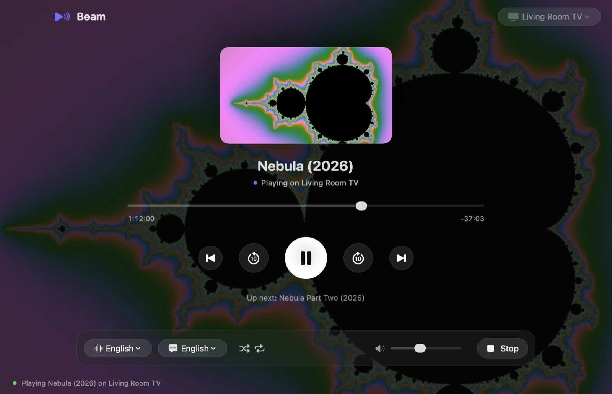

<p align="center">
  
</p>

<h1 align="center">Beam</h1>

<p align="center">
  Play the movies on your Mac on any Chromecast or Google Cast TV.<br>
  <a href="https://github.com/prasad-kumkar/beam-cast/releases/latest"><b>Download</b></a> ·
  <a href="https://prasad-kumkar.github.io/beam-cast/">Website</a> ·
  <a href="#license">License</a>
</p>

<p align="center">
  
</p>

Beam is a Chromecast player for Mac. Drop a video file on it, pick your TV, and it plays on the big screen: no Chrome tab, no uploading, no converting. It handles the things that usually go wrong when casting from a MacBook: MKV files, 4K HEVC, external and embedded subtitles, multiple audio languages, and binge-watching a whole season.

## Features

- **Cast local files to Chromecast**: MP4, MKV, M4V, MOV and WebM up to 4K HEVC (H.265) and H.264, streamed straight from your Mac over Wi-Fi
- **Chromecast subtitles**: SRT, VTT and ASS/SSA files next to the movie, or tracks embedded in it, picked up automatically; adjust timing and style (size, color, background) while playing
- **Audio tracks**: switch language or commentary tracks; Beam remembers your preferred language
- **Up Next**: drop several files or a whole season to queue them, with auto-play, shuffle and repeat
- **Resume**: every movie continues where you stopped
- **Remote-style controls**: play/pause, ±10 s, previous/next, scrubbing, TV volume and mute
- **Media keys and Control Center**: control playback while Beam is in the background
- Finds Cast TVs automatically and remembers the last one you used
- Keeps your Mac awake while casting and stops the TV app when you quit
- Each session is served on a random private URL that only your TV knows

## Install

1. Download **Beam-x.y.z.dmg** (drag Beam to Applications) or **Beam-x.y.z.pkg** (installer) from the [latest release](https://github.com/prasad-kumkar/beam-cast/releases/latest).
2. Open Beam. Current builds aren't notarized by Apple yet, so the first launch shows *"Beam" Not Opened*. Click **Done**, then go to **System Settings › Privacy & Security**, scroll down and click **Open Anyway** next to Beam. You only do this once. (Terminal alternative: `xattr -dr com.apple.quarantine /Applications/Beam.app`)
3. Allow **Local Network** access when asked, so Beam can find your TV.
4. Optional but recommended: `brew install ffmpeg` enables poster frames, embedded subtitles, ASS/SSA files and audio track switching.

Requirements: macOS 13 Ventura or later (Apple silicon M1–M4 or Intel), and your Mac and TV on the same network.

**Works with** Chromecast, Chromecast Ultra, Chromecast with Google TV, Google TV Streamer, and Google TV / Android TV smart TVs (Sony, TCL, Hisense, Philips and others).

## Usage

Drop a movie (or several) on the window, pick your TV in the top-right corner, and press **Play on TV**.

| Key | Action |
| --- | --- |
| Return | Play / Resume on TV |
| Space | Play / Pause |
| ← / → | Back / Forward 10 s |
| ↑ / ↓ | TV volume |
| M | Mute |
| C | Subtitles on / off |
| ⌘O | Choose movies |
| Esc | Stop casting |

Tips:
- **Subtitles out of sync?** Subtitles › Adjust Timing. Use + if they show too early, − if too late.
- **Stuttering?** MP4 (H.264 or HEVC) plays most smoothly; some TVs handle MKV less well.
- Scripting: `open -a Beam --args -movie /path/movie.mkv -subtitles /path/movie.srt -autocast YES`

## FAQ

**How do I cast a video from my Mac to Chromecast without Chrome?** Open the file in Beam, choose your TV, press Play on TV. Beam talks to the Chromecast directly.

**Can I play MKV files on Chromecast from a Mac?** Yes, Beam streams MKV (and MP4/MOV) directly. Whether a specific codec plays depends on your TV; MP4 with H.264 or HEVC is the most compatible.

**Why are my Chromecast subtitles out of sync?** The subtitle file was timed for a different release. Use Subtitles › Adjust Timing to shift them while you watch.

**How do I change the audio language on Chromecast?** Pick a track from Beam's audio menu; Beam switches it on the TV.

## Build from source

```sh
swift test --build-path work/test   # unit tests
./scripts/build-app.sh              # universal, ad-hoc signed outputs/Beam.app
./scripts/package.sh                # outputs/Beam-<version>.dmg and .pkg
```

Requires Xcode 16 or later. Set `SIGN_IDENTITY="Developer ID Application: …"` to sign with your certificate, and `INSTALLER_SIGN_IDENTITY` / `NOTARY_PROFILE` for a signed, notarized package.

### Releases

Push a version tag and GitHub Actions builds, tests and publishes the `.dmg` and `.pkg`:

```sh
git tag v1.2.0 && git push origin v1.2.0
```

The [release workflow](.github/workflows/release.yml) signs and notarizes when these repository secrets exist, and makes ad-hoc signed packages otherwise: `MACOS_CERTIFICATE_P12`, `MACOS_CERTIFICATE_PASSWORD`, `APPLE_TEAM_ID`, `APPLE_ID`, `APPLE_APP_PASSWORD`.

The website in [`site/`](site/) deploys to GitHub Pages on every push to `main` (enable Pages › Source: GitHub Actions in the repository settings).

### Project layout

| Path | What it is |
| --- | --- |
| `Sources/Beam/Chromecast.swift` | Cast discovery (Bonjour) and the Cast V2 protocol client |
| `Sources/Beam/LocalFileServer.swift` | HTTP server that streams the movie and subtitles to the TV, with range requests for seeking |
| `Sources/Beam/MediaInspector.swift` | ffmpeg helpers: tracks, poster frames, subtitle extraction, audio variants |
| `Sources/Beam/Subtitles.swift` | SRT/VTT → WebVTT conversion, timing offsets, subtitle styles |
| `Sources/Beam/AppModel.swift` | App state: queue, tracks, casting, resume, media keys |
| `Sources/Beam/ContentView.swift` | SwiftUI interface |

## License

Beam is source-available under the [Business Source License 1.1](LICENSE).

- **Free** for personal, non-commercial use, such as streaming your own media at home.
- **Commercial use** (use by or for a business, bundling Beam with another product, or offering it as a paid or hosted service) requires a commercial license. [Open an issue](https://github.com/prasad-kumkar/beam-cast/issues) to get in touch.
- Each version converts to the **Apache License 2.0** four years after release (for 1.2.0: 2030-10-19).

Chromecast and Google Cast are trademarks of Google LLC. Beam is not affiliated with or endorsed by Google.
